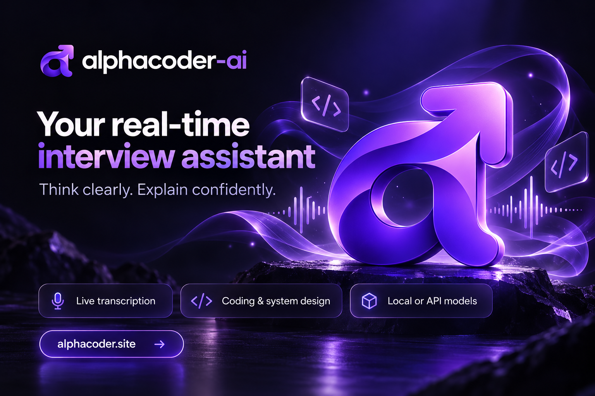

  

<h1 align="center">Alphacoder AI</h1>

Your real-time interview assistant. Think clearly. Explain confidently.

  <a href="https://alphacoder.site">Website</a> ·
  <a href="https://alphacoder.site/downloads.html">Downloads</a> ·
  <a href="https://alphacoder.site/account.html"> Try Now</a> ·
  <a href="https://alphacoder.site/contact.html">Support</a>

About
Alphacoder AI brings live speech transcription, streaming AI responses and your personal context into one Windows desktop workspace. Prepare for coding, behavioral, project, resume and system design questions with configurable models and a readable, focused interface.
This repository hosts Alphacoder release downloads and product information. Find the official website at alphacoder.site.
Features
Live transcription: transcribe speech locally with whisper.cpp and your selected speech model.
Streaming responses: use local Ollama models or a configured API provider.
Interview context: add your resume, job description and project notes to ground responses in your own information.
Coding and system design: work through approaches, edge cases, complexity and architectural trade-offs.
Behavioral preparation: practise clear answers using your real experience, with configurable answer formats and length.
Follow-up questions: build on the conversation and ask for simpler explanations, examples or shorter answers.
Desktop controls: choose themes, adjust reading size and manage supported window visibility settings.
Flexible installation: download selected dependencies during setup or choose compatible files you already have.
Download
Download the installer that fits your PC from the official Downloads page, or browse GitHub Releases.
Build	Choose it when
CPU — Windows x64	You do not have a compatible NVIDIA GPU, or prefer CPU processing.
CUDA — Windows x64	You have an NVIDIA GPU supported by the release's compiled CUDA architectures and a compatible driver.
The online installer keeps the initial download small by supplying application files separately from larger runtime and model downloads. The total installation size depends on the dependencies and models you select.
Installation
Download the CPU or CUDA installer.
Run setup and choose an installation directory.
Download the required dependencies when prompted, or select compatible existing dependency paths.
Select a Whisper speech model and configure your response provider. For local responses, choose an installed Ollama model.
Launch Alphacoder AI, sign in through the browser and complete device activation.
Add your resume or relevant context, select your audio settings and start your practice session.
If you create an account with email, confirm your email before signing in. Use the account page's confirmation resend option if needed. Account and device activation require an internet connection and a valid subscription.
Requirements
Windows 10 22H2 or Windows 11, 64-bit.
Internet access for account activation and selected dependency downloads.
Enough memory and disk space for your chosen speech and response models.
For CUDA: supported NVIDIA hardware and a compatible driver. CUDA support depends on the particular release; it does not cover every NVIDIA GPU.
For API responses: an account and credentials for the configured provider. Provider usage may have separate charges.
The website and account portal work on mobile. The desktop releases are for Windows x64; native Linux and macOS installers are not currently provided.
Privacy and model choice
Local speech transcription runs on your computer. Ollama can process responses locally; API providers process the requests you send to them. Account activation communicates with the online account service even when you choose local models.
Window visibility and capture exclusion settings depend on Windows and the capture method. They do not guarantee invisibility or remove the application from system process lists.
Read the Privacy page for details. Alphacoder AI is intended for interview preparation and permitted assistance.
Support
For account, activation or subscription help, visit Support. For application problems, open an issue with your Windows version, CPU/CUDA build, application version and a description of the problem. Remove personal data and credentials from any logs you share.
---

Alphacoder Inc. · <a href="https://alphacoder.site">alphacoder.site</a>

